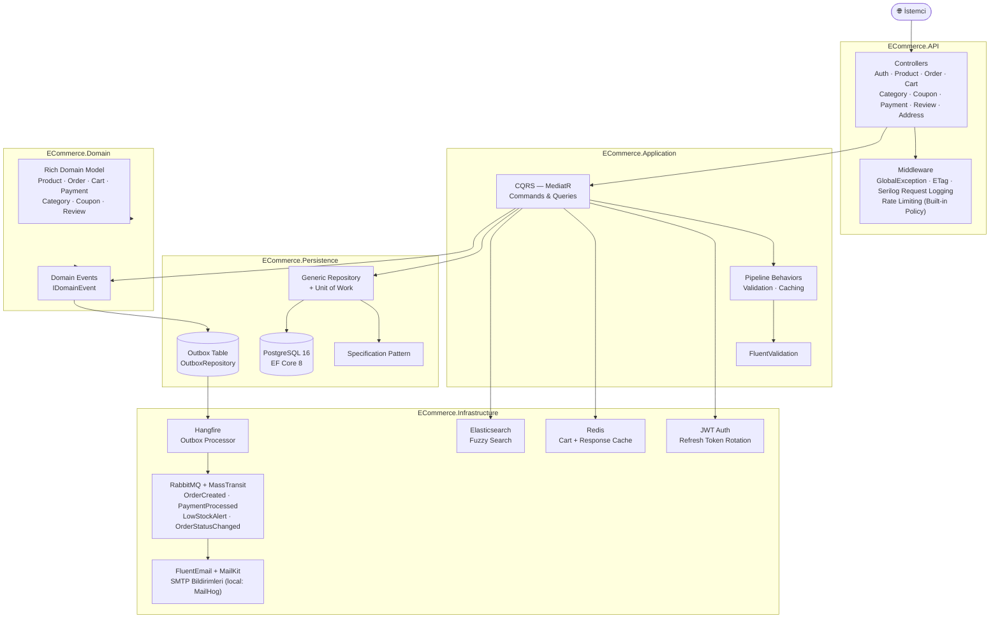

<div align="center">

[](README.md)
[](README.en.md)

# 🛒 ECommerce API

**.NET 8** ile geliştirilmiş, **Clean Architecture** ve **CQRS** desenlerini kullanan  
production-ready E-Ticaret RESTful API.

[](https://github.com/Muhametaydn/ECommerceAPI/actions/workflows/ci.yml)
[](https://dotnet.microsoft.com/)
[](https://www.postgresql.org/)
[](https://redis.io/)
[](https://www.rabbitmq.com/)
[](https://www.elastic.co/)
[](https://www.docker.com/)
[](LICENSE)

</div>

---

## 📖 Proje Hakkında

Bu proje, modern yazılım geliştirme pratiklerini bir arada kullanan kapsamlı bir e-ticaret backend API'sidir. Gerçek dünya senaryolarını karşılayacak şekilde tasarlanmış olup aşağıdaki konuları kapsamaktadır:

- **Temiz ve sürdürülebilir kod** — Clean Architecture sayesinde her katmanın tek bir sorumluluğu var
- **Ölçeklenebilir mimari** — CQRS ile okuma ve yazma işlemleri birbirinden bağımsız
- **Güvenilir mesajlaşma** — Outbox Pattern ile event'ler asla kaybolmuyor
- **Yüksek performans** — Redis cache, ETag ve Elasticsearch ile optimize edilmiş
- **Production hazırlığı** — Docker, CI/CD, Serilog logging ile deploy'a hazır

---

## 🏗️ Mimari



---

## 🛠️ Tech Stack

| Kategori | Teknoloji | Neden? |
|---|---|---|
| Framework | .NET 8, ASP.NET Core Web API | LTS sürümü, yüksek performans |
| ORM | Entity Framework Core 8 | Code-first migration, LINQ desteği |
| Veritabanı | PostgreSQL 16 | Güvenilir, ACID uyumlu ilişkisel DB |
| Cache | Redis 7 | Düşük latency, Cart + Response cache |
| Arama | Elasticsearch 8.13 | Fuzzy arama, dil analizi |
| Mesajlaşma | RabbitMQ 3.13 + MassTransit 8 | Güvenilir async event işleme |
| Background Jobs | Hangfire | Outbox job scheduling, retry mekanizması |
| Auth | ASP.NET Identity + JWT | Endüstri standardı, token rotation |
| Email | FluentEmail + MailKit | HTML template desteği |
| Loglama | Serilog | Structured logging, sink desteği |
| API Docs | Swagger / OpenAPI | Otomatik dokümantasyon |
| Test | xUnit, Moq, FluentAssertions, NetArchTest | Unit + Integration + Mimari testler |
| DevOps | Docker, GitHub Actions | Container + CI/CD otomasyonu |

---

## ✨ Özellikler

### 🏛️ Clean Architecture
Proje 4 katmana ayrılmıştır: **Domain → Application → Infrastructure/Persistence → API**. Her katman yalnızca bir alt katmana bağımlıdır. Bu sayede infrastructure değişiklikleri domain'i etkilemez, test yazımı kolaylaşır.

### ⚡ CQRS + MediatR
Okuma (Query) ve yazma (Command) işlemleri tamamen ayrı handler'larda yönetilir. MediatR pipeline behavior'ları ile her request için otomatik validation, caching ve logging uygulanır.

### 📨 Domain Events + Outbox Pattern
Sipariş oluşturulduğunda domain event raise edilir. Outbox pattern sayesinde event veritabanına kaydedilir, Hangfire her dakika işleyip RabbitMQ'ya iletir. Böylece **hiçbir event kaybolmaz** — servis çökmesi bile güvenliği bozmaz.

### 🔐 JWT + Refresh Token Rotation
Access token 15 dakika, refresh token 7 gün geçerlidir. Her refresh işleminde eski token iptal edilip yenisi üretilir (rotation). Bu sayede token çalınsa bile kısa sürede geçersiz hale gelir.

### 🚀 Redis Cache + ETag
Sık kullanılan sorgular (ürün listesi, kategori ağacı) Redis'te önbelleğe alınır. ETag middleware ile istemci aynı veriyi tekrar istediğinde `304 Not Modified` döner — bandwidth tasarrufu sağlar.

### 🔍 Elasticsearch Fuzzy Search
Ürün araması Elasticsearch üzerinden yapılır. Yazım hataları tolere edilir (fuzzy matching), ürün adına ağırlık verilerek sıralama yapılır.

### 📊 Policy-Based Authorization
`Admin`, `Seller`, `Customer` rolleri ve bunlara göre `AdminOnly`, `SellerOrAdmin`, `CustomerOnly`, `Authenticated` policy'leri tanımlıdır. Her endpoint hangi role açık olduğunu açıkça belirtir.

### 🛡️ Rate Limiting
Auth endpoint'leri 5 istek/dakika, API endpoint'leri 30 istek/dakika, global ise IP başına 60 istek/dakika ile sınırlandırılmıştır. DDoS ve brute force koruması sağlar.

---

## 🚀 Hızlı Başlangıç

### Gereksinimler

- [.NET 8 SDK](https://dotnet.microsoft.com/download/dotnet/8)
- [Docker & Docker Compose](https://www.docker.com/get-started)

### 1. Repoyu klonla

```bash
git clone https://github.com/Muhametaydn/ECommerceAPI-CleanArchitecture.git
cd ECommerceAPI-CleanArchitecture
```

### 2. Altyapı servislerini başlat

```bash
docker compose up -d postgres redis rabbitmq mailhog elasticsearch
```

### 3. Yerel sırları ayarla (bir kez)

Parolalar ve JWT anahtarı repoya konmaz; .NET user-secrets ile yalnızca senin bilgisayarında saklanır.
Değerler `docker compose` ile başlatılan yerel servislerle eşleşir.

```bash
cd src/ECommerce.API
dotnet user-secrets set "JwtSettings:SecretKey" "$(openssl rand -hex 32)"
dotnet user-secrets set "ConnectionStrings:DefaultConnection" "Host=localhost;Port=5432;Database=ECommerceDB;Username=postgres;Password=root"
dotnet user-secrets set "RabbitMQ:Password" "guest"
```

> JWT anahtarı olmadan API **açılmaz** (boş, 32 bayttan kısa veya örnek anahtar kabul edilmez).

### 4. API'yi çalıştır

```bash
dotnet run
```

Swagger UI: **http://localhost:5000/swagger**

### 5. Tüm stack'i Docker ile başlat (opsiyonel)

```bash
docker compose up -d
```

API: **http://localhost:8080** | Swagger: **http://localhost:8080/swagger**

---

## ⚙️ Ortam Değişkenleri

| Değişken | Açıklama | Varsayılan |
|---|---|---|
| `ConnectionStrings__DefaultConnection` | PostgreSQL bağlantı dizesi | `Host=localhost;...` |
| `ConnectionStrings__Redis` | Redis bağlantı dizesi | `localhost:6379` |
| `JwtSettings__SecretKey` | JWT imzalama anahtarı (≥32 bayt, rastgele). Compose'ta `JWT_SECRET_KEY` | — (zorunlu) |
| `ReverseProxy__KnownProxies__0` / `ReverseProxy__KnownNetworks__0` | `X-Forwarded-For` başlığına güvenilecek proxy IP'si / ağı (CIDR). Frontend sunucusunun adresi verilmeli | yalnızca loopback |
| `FraudDetection__Enabled` | Fraud servisi entegrasyonu (`ECommerceFraud` reposu). Kapalıyken sipariş akışı birebir aynıdır | `false` |
| `FraudDetection__Mode` | `Monitor`: kararlar kaydedilir, sipariş bekletilmez. `Enforce`: incelemedeki sipariş onaylanamaz, analist reddederse iptal edilir | `Monitor` |
| `RabbitMQ__Host` | RabbitMQ host | `localhost` |
| `Elasticsearch__Uri` | Elasticsearch URI | `http://localhost:9200` |
| `Email__Host` | SMTP host | `localhost` |

> ⚠️ API, anahtar boş, 32 bayttan kısa veya örnek (placeholder) değerdeyse **başlamaz**. Anahtar üretmek için: `openssl rand -hex 32`.
> Production compose: `JWT_SECRET_KEY=... docker compose -f docker-compose.yml up -d`
>
> Rate limit istemci başına uygulanır (giriş: IP başına 5/dk; API: kullanıcı ya da IP başına 30/dk). Frontend proxy'si güvenilir ağda değilse tüm kullanıcılar tek istemci sayılır.

---

## 📡 API Endpoints

### Auth — `/api/v1/auth`

| Method | Path | Açıklama |
|---|---|---|
| `POST` | `/register` | Yeni kullanıcı kaydı |
| `POST` | `/login` | Giriş → JWT + Refresh token |
| `POST` | `/refresh-token` | Access token yenileme |
| `POST` | `/revoke-token` | Refresh token iptal |

### Products — `/api/v1/products`

| Method | Path | Yetki | Açıklama |
|---|---|---|---|
| `GET` | `/` | — | Ürün listesi (sayfalı, filtrelenebilir) |
| `GET` | `/{id}` | — | Ürün detayı |
| `GET` | `/search?q=...` | — | Elasticsearch fuzzy arama |
| `GET` | `/admin` | Admin | Onay durumu ve satıcı bilgisiyle bütün ürünler |
| `GET` | `/mine` | SellerOrAdmin | Oturumdaki satıcının ürünleri |
| `POST` | `/` | SellerOrAdmin | Ürün oluştur |
| `PUT` | `/{id}` | SellerOrAdmin | Ürün güncelle |
| `POST` | `/{id}/approve` | Admin | Ürünü onayla ve yayınla |
| `POST` | `/{id}/reject` | Admin | Ürünü reddet ve yayından kaldır |
| `DELETE` | `/{id}` | Admin | Ürün sil |

### Product Images — `/api/v1/product-images`

| Method | Path | Yetki | Açıklama |
|---|---|---|---|
| `POST` | `/` | SellerOrAdmin | En fazla 5 MB JPEG, PNG veya WebP ürün görseli yükler |

Yüklenen görseller `/uploads/products/{dosya}` adresinden sunulur ve Docker ortamında kalıcı `product_images` volume'unda saklanır.

### Orders — `/api/v1/orders`

| Method | Path | Yetki | Açıklama |
|---|---|---|---|
| `GET` | `/` | Authenticated | Siparişlerim |
| `GET` | `/admin` | Admin | Bütün siparişleri listele |
| `GET` | `/seller` | SellerOrAdmin | Satıcının ürün kalemlerini içeren siparişleri listele |
| `GET` | `/{id}` | Authenticated | Sipariş detayı |
| `POST` | `/` | Customer | Sipariş oluştur |
| `PATCH` | `/{id}/status` | SellerOrAdmin | Onayla, kargola veya teslim et |
| `POST` | `/{id}/cancel` | Authenticated | İptal et |

### Admin — `/api/v1/admin`

| Method | Path | Yetki | Açıklama |
|---|---|---|---|
| `GET` | `/users` | Admin | Kullanıcıları rolleriyle listele |
| `PUT` | `/users/{id}/seller-role` | Admin | Kullanıcıyı satıcı veya müşteri yap |
| `GET` | `/dashboard` | Admin | Ciro, sipariş ve kullanıcı istatistikleri |
| `GET` | `/marketplace-settings` | Admin | Otomatik ürün onay ayarını getir |
| `PUT` | `/marketplace-settings` | Admin | Otomatik ürün onay ayarını değiştir |

Yerel geliştirme ortamında (`ASPNETCORE_ENVIRONMENT=Development` + `SeedDemoUsers__Enabled=true`) satıcı panelini denemek için `seller@outlook.com` / `Seller123!` hesabı otomatik oluşturulur. Demo hesaplar Development dışında hiçbir zaman oluşturulmaz.

### Diğer Endpoint'ler

| Prefix | Açıklama |
|---|---|
| `/api/v1/cart` | Sepet işlemleri (Redis tabanlı) |
| `/api/v1/categories` | Hiyerarşik kategori yönetimi |
| `/api/v1/coupons` | Kupon oluşturma ve uygulama |
| `/api/v1/addresses` | Kullanıcı adres yönetimi |
| `/api/v1/reviews` | Ürün değerlendirmeleri |
| `/api/v1/payments` | Ödeme işlemleri |

---

## 🧪 Testler

```bash
# Unit testler
dotnet test tests/ECommerce.UnitTests

# Entegrasyon testleri
dotnet test tests/ECommerce.IntegrationTests

# Mimari testler (katman bağımlılıkları)
dotnet test tests/ECommerce.ArchitectureTests

# Tümü
dotnet test ECommerceAPI.sln
```

---

## 🛠️ Geliştirme Araçları

| Servis | URL | Bilgi |
|---|---|---|
| Swagger UI | http://localhost:5000/swagger | API dokümantasyonu |
| Hangfire Dashboard | http://localhost:5000/hangfire | Background job yönetimi (dev) |
| RabbitMQ Management | http://localhost:15672 | guest / guest |
| MailHog | http://localhost:8025 | Test email inbox |
| Kibana | http://localhost:5601 | Elasticsearch görselleştirme |

---

## 📁 Proje Yapısı

```
ECommerceAPI/
├── .github/
│   └── workflows/
│       └── ci.yml               # GitHub Actions — Build · Test · Docker Push
├── src/
│   ├── ECommerce.Domain         # Entity, Enum, Interface, Specification, Domain Events
│   ├── ECommerce.Application    # Features (CQRS), DTOs, Validators, Behaviors, Mapping
│   ├── ECommerce.Infrastructure # JWT, Redis, Elasticsearch, RabbitMQ, Email, Hangfire Jobs
│   ├── ECommerce.Persistence    # EF Core DbContext, Repositories, UoW, Migrations
│   └── ECommerce.API            # Controllers, Middleware, Program.cs
├── tests/
│   ├── ECommerce.UnitTests      # Domain + Application katmanı unit testleri
│   ├── ECommerce.IntegrationTests # Gerçek DB ile entegrasyon testleri
│   └── ECommerce.ArchitectureTests # Katman bağımlılık kuralları (NetArchTest)
├── docker-compose.yml           # Tüm servisler (prod)
├── docker-compose.override.yml  # Dev ortamı overrides
├── Dockerfile                   # Multi-stage build
└── ECommerceAPI.sln
```

---

## 📄 Lisans

MIT - Detaylar için [LICENSE](LICENSE) dosyasına bakın.

## Güvenlik taraması ve yerel yapılandırma

- PostgreSQL ve RabbitMQ parolalarını ortam değişkenleriyle (`ConnectionStrings__DefaultConnection`, `RabbitMQ__Password`) verin. Yerel geliştirmede git tarafından yok sayılan `src/ECommerce.API/appsettings.Development.json` kullanılabilir. Bu dosya Docker imajına dahil edilmez. Gerçek ortamlarda demo kimlik bilgilerini kullanmayın.
- SMTP için varsayılan `EmailSettings:EnableSsl` değeri `true` olur. TLS kapatma yalnızca yerel MailHog içindir: geliştirme ayarları ve yerel Docker Compose bunu açıkça `false` olarak ayarlar. Gerçek SMTP sunucusunda TLS'i açık tutun; SonarQube SMTP bulgusunu kullanılan ortamla birlikte değerlendirin.
- Auth işlemleri ve rate limit istemci IP'sini kullanır. `X-Forwarded-For` yalnızca `ReverseProxy:KnownProxies` / `ReverseProxy:KnownNetworks` içindeki proxy'lerden kabul edilir (varsayılan: yalnızca loopback). Reverse proxy arkasında yayınlarken frontend sunucusunun adresini bu ayara ekleyin.
- Anonim sepet için `X-Cart-Id` ve birleştirme isteğindeki `AnonymousCartId`, boş olmayan `xxxxxxxx-xxxx-xxxx-xxxx-xxxxxxxxxxxx` biçiminde UUID olmalıdır. İstemci, oluşturulan sepet kimliğinin `cart:anon:` önekinden sonraki UUID bölümünü sonraki isteklerde korumalıdır. Bu kimlik gizli bir erişim belirteci gibi ele alınmalıdır.
- ETag SHA-256 kullanır. `.sonarqube/` yerel analiz çıktısıdır; git'e ve Docker imajına dahil edilmez. SonarQube'deki test kapsamı için ayrıca coverage raporu üretip tarayıcıya vermek gerekir.

### SonarQube ve test kapsamı

SonarQube yerelde `http://localhost:9000` adresinde çalışırken, .NET SDK ve `dotnet-sonarscanner` kurulu bir CMD penceresinde repo kökünden çalıştırın:

```cmd
scripts\Analyze-SonarQube.cmd YOUR_SONAR_TOKEN
```

Script sırasıyla analiz başlangıcı, tam derleme, tüm test projelerinde coverage toplama ve sonuç yükleme adımlarını çalıştırır. `coverage.runsettings`, mevcut Coverlet collector ile OpenCover ve Cobertura raporları üretir. SonarQube, `sonar.cs.opencover.reportsPaths` üzerinden OpenCover raporlarını okur; TRX sonuçları da ayrıca aktarılır. Test kodları kapsam ölçümüne dahil edilmez; uygulama kodu, controller'lar ve migration'lar bu ayarla kapsam dışına çıkarılmaz.

Her çalıştırmanın çıktısı git tarafından yok sayılan `test-results/sonar/<run-id>/` klasöründe tutulur; önceki raporlar yeni analize karıştırılmaz. Derleme veya test başarısız olursa script yükleme adımına geçmez. CI test adımları da aynı rapor biçimini kullanır; yerel SonarQube sunucusuna CI üzerinden otomatik yükleme yapılmaz.

Coverage, geçen test sayısı değil, çalıştırılan uygulama kodunun oranıdır. Raporun aktarılması %80 eşiğinin geçileceğini garanti etmez; ölçümden sonra eksik test senaryoları belirlenir. PostgreSQL/Redis testleri için `ECOMMERCE_TEST_POSTGRES` ve `ECOMMERCE_TEST_REDIS` yalnızca ayrı test servislerini göstermelidir; bu değişkenler yokken ilgili isteğe bağlı testler atlanabilir.

---

## 🔒 Güvenlik ve Kalite Denetimi (Kasım 2026)

Backend (bu repo) ve frontend (`ECommerceFrontend`) birlikte uçtan uca denetlendi. Bulunan her açık ve hata için önce onu yakalayan bir test yazıldı, sonra düzeltildi.

### Test sonuçları

| | Denetim öncesi | Denetim sonrası |
|---|---|---|
| Backend testleri | 330 | **405** (Unit 300, Integration 101, Architecture 4), hepsi geçiyor |
| Frontend unit testleri | 104 | **113**, hepsi geçiyor |
| Frontend E2E (Playwright) | — | **28/28** geçiyor (storefront, admin, seller) |
| Kapsam: Application | %61 | **%72** |
| Kapsam: Domain | %83 | **%88** |
| Bağımlılık açıkları (NuGet / npm) | 2 yüksek / 9 (1 kritik) | **0 / 1** (aşağıya bakın) |

Yeni test grupları: rate limit ve proxy güveni, login kilitleme, refresh token yeniden kullanımı, hata yanıtı sızıntısı, sipariş/kupon/ödeme/stok yaşam döngüsü, iptal ve iade, ürün silme, yorum ve adres sahipliği (IDOR), kupon doğrulama, sepet güncelleme, Outbox job, open redirect.

### Kapatılan güvenlik açıkları

| # | Açık | Etki | Çözüm |
|---|---|---|---|
| 1 | Rate limit tüm siteye tek sayaçtı | Bir kişinin dakikada 5 hatalı girişi **tüm kullanıcıların** girişini engelliyordu | İstemci başına limit (IP / kullanıcı). `X-Forwarded-For` yalnızca güvenilir proxy'den kabul edilir, frontend başlığı iletir |
| 2 | Repoda açık JWT anahtarı | Production'da herkes sahte **Admin** token üretebilirdi | Anahtar boş, kısa veya örnek değerdeyse API başlamaz |
| 3 | Production'da bilinen şifreli demo admin | `Admin123!` ile yönetici girişi | Demo hesaplar yalnızca Development ortamında oluşur |
| 4 | Brute-force koruması yok | Sınırsız şifre denemesi | 5 hatalı denemede 15 dk hesap kilidi |
| 5 | Refresh token çalınması fark edilmiyordu | Çalınan token sessizce kullanılabilirdi | Rotasyonla değişmiş token tekrar kullanılırsa tüm oturumlar kapanır (çoklu sekme için 30 sn tolerans) |
| 6 | `revoke-token` sahiplik kontrolü yoktu | Başkasının oturumu kapatılabilirdi | Yalnızca kendi token'ı iptal edilebilir |
| 7 | Hata yanıtlarında iç ayrıntı | EF/LINQ ayrıntıları ve dosya yolları istemciye gidiyordu | Yalnızca uygulama kodunun mesajları gösterilir, diğerleri genel 500 döner |
| 8 | Frontend open redirect | `/giris?redirect=/\evil.com` girişten sonra saldırgan sitesine yönlendiriyordu | Yönlendirme sabit bir kökle çözümlenip doğrulanıyor |
| 9 | Next.js kritik RCE ve diğer açıklar | Image Optimizer üzerinden uzaktan kod çalıştırma | next 15.5.27 → 15.5.29, follow-redirects → 1.16.3, AutoMapper 16.1.1 → 16.3.0 |
| 10 | Login route'u backend hatasını gösteriyordu | İç adres ve bağlantı bilgisi sızıyordu | Genel mesaj döner, ayrıntı sunucu loguna yazılır |

### Düzeltilen mantık hataları

- **Ürün silmek, o ürünü içeren tüm eski siparişlerin satırlarını siliyordu** (FK `Cascade`). FK artık `Restrict` (migration `RestrictOrderItemProductDelete`). Siparişte geçen ürün silinmez, satıştan kaldırılır.
- İptal edilen sipariş kupon kullanım hakkını geri vermiyordu.
- Yüzdelik indirimler kuruşa yuvarlanmıyordu (33,3333 TL gibi tutarlar çıkıyordu).
- İade durumu doğrudan atanıyordu, müşteriye iade e-postası gitmiyordu. Artık `Order.MarkAsRefunded()` ile yapılıyor ve event yayınlanıyor.
- Kargodaki sipariş domain kuralında iptal edilebiliyordu. Tamamlanmış ödeme "başarısız" yapılabiliyordu.
- Sepet birleştirilince ürün görselleri kayboluyordu. Satıştan kalkmış ürünün sepet miktarı artırılabiliyordu.
- Outbox, broker'ın gerçek hatası yerine anlamsız bir reflection mesajı kaydediyordu.
- `NotFoundException` mesajı bozuktu.
- `DbSet<User>` kaldırıldıktan sonra EF, `Users` tablosunu yeniden adlandırmaya çalışıyordu. Tablo adı sabitlendi.

### Bilinen ve kabul edilen kalan riskler

- **Zod 3 (frontend):** Büyük dizilerin doğrulanmasında bellek tüketimi açığı var, düzeltmesi Zod 4 gerektiriyor. Formlarda dizi doğrulanmadığı için istismar yolu yok. Major yükseltme ayrıca planlanacak.
- **Ödeme simülasyon:** Sipariş onaylanınca ödeme otomatik "tamamlandı" sayılıyor. Gerçek ödeme sağlayıcısı entegrasyonuna kadar bu tasarım böyle kalıyor.
- Elasticsearch, e-posta ve RabbitMQ consumer sınıfları için henüz test yok. Bunlar gerçek servisle integration test gerektiriyor.

### Testleri çalıştırma

```bash
# Backend (PostgreSQL/Redis testleri için ayrı, geçici test servisleri)
ECOMMERCE_TEST_POSTGRES="Host=localhost;Port=55432;Username=postgres;Password=..." \
ECOMMERCE_TEST_REDIS="localhost:56379" \
dotnet test ECommerceAPI.sln --settings coverage.runsettings

# Frontend (ECommerceFrontend klasöründe)
pnpm test && pnpm typecheck && pnpm lint
pnpm build && pnpm test:e2e   # Playwright tarayıcısı yoksa: E2E_CHROME_PATH=<chrome.exe yolu>
```
